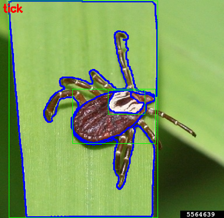

# 基于Mask R-CNN的蜱虫识别系统的设计与实现

> 本科毕业设计 · 蜱虫检测计数 / 蜱种鉴定 / 部件实例分割（深化方向）

用户上传一张照片，系统回答：**图上有几只蜱虫、每一只在哪、分别是什么蜱种**；不是蜱虫的照片给出"疑似什么昆虫"的兜底识别。部件级实例分割（盾板、足等）为深化方向；叮咬伤口分割（M3）为规划中的扩展模块，数据集已就绪。

当前交付形态为 **Web 应用**（Vue 3 + FastAPI + Docker 一键部署）；微信小程序、桌面 GUI、边缘部署（ONNX + INT8 量化）为规划中的多平台扩展。AI 协作约定见 [CLAUDE.md](CLAUDE.md)，总体路线见 [毕业设计/毕业设计系统规划.md](毕业设计/毕业设计系统规划.md)。

实例分割示例（SAM 自动标注 AMG 模式）：



## 系统架构：三模型级联

```
上传图片
   │
   ▼
全图检测 M1（Mask R-CNN v3，1024 分辨率）          ← 第一道闸：对蜱虫判别力最强
   ├── 检出 ──▶ 带上下文的逐框蜱种分类（28物种）──▶ 匹配输入方式的校准阈值
   │              ├─ 单目标：区域/整图双视图融合；多目标：仅当前区域
   │              └─ 待确认：保留候选与Top3，逐框昆虫复核
   ├── 未检出 ─▶ 切块检测补偿（2×2，小目标放大再试）──▶ 仍未检出 ─▶ 昆虫粗分类兜底
   │
   └── 整图昆虫分类用于逐框冲突复核与兜底；独立模型置信度不直接比较
```

- **检测优先**（v2 改版）：全图推理永远第一优先，切块只作未检出时的补偿——切块会把大蜱虫拦腰切碎
- **兜底粗分类**：未定位时用28类昆虫分类给出候选；整图分类也参与逐框冲突复核，因此须同时评估其误拒绝与误保留
- **重叠去重（兼数量统计）**：全图/切块路径统一按分数贪心去重（IoU>0.3视为重复候选）。返回候选实例数量，并区分蜱种已确认和待确认
- 本优化实践分支由智能体开发，不修改或合并主分支，授权见 [AGENTS.md](AGENTS.md)。配置入口为 `configs/inference_optimization.json`，实验口径、限制及对比见 [优化评估](docs/optimization_results.md)。旧权重与实践报告不覆盖。
- 推理视图变化必须重新校准；当前验证比较选择了全局阈值回退，未强制采用分物种阈值。多目标使用独立的区域阈值，混合物种场景仍需人工标注验证。

## 模型与实验结果

| 模块                          | 模型                       | 数据                                                  | 指标                                       | 产物                                 |
| ----------------------------- | -------------------------- | ----------------------------------------------------- | ------------------------------------------ | ------------------------------------ |
| M1 蜱虫检测                   | Mask R-CNN R50-FPN         | 1715 训练图（含 579 小目标补标）/ 332 验证 / 134 测试 | **mAP@0.50 = 0.866**（1024 评估）    | `output/det_v3/`                   |
| M2 蜱种分类（基线中心裁剪） | ResNet-50                  | 清洗后 28 物种 5890 张，448px 训练与推理 | test acc 75.6% /**F1 0.742**         | `output/tick_species_clean_448/`   |
| M2 蜱种分类（3 类基线）       | ResNet-50                  | 3 大媒介蜱种                                          | **test acc 89.5%** / F1 89.1%        | `output/tick_species_3_results/`   |
| M2 蜱种分类（31 类消融）      | ResNet-50                  | 31 类加权采样 + 标签平滑                              | test acc 65.9% / F1 0.641                  | `output/tick_species_31_weighted/` |
| 昆虫粗分类（基线中心裁剪） | ResNet-50                  | 10426 张，224px                                       | **test acc 94.25%** / macro-F1 0.837 | `output/insect_classifier/`        |
| M3 叮咬伤口分割               | Mask R-CNN（复用训练管线） | tick-bite 1032 图 / 1806 多边形                       | ⏳ 待训练（WP3）                           | —                                   |

关键技术点：

- **SAM 辅助标注**：以 bbox 为提示补全主数据集 1649 条真实分割掩码（0 失败）；AMG 无提示模式试点 7 类 210 图（`output/sam_pilot/`）
- **分物种置信阈值**（复现 Villon et al. 2020）：不同蜱种分类难度不同，低于阈值输出"不确定"而非硬判——"宁可不答，不要猜错"
- **数据质量驱动**：检测模型辅助清洗蜱种数据（零检出=噪声剔除、多虫/小目标=保留），448 分辨率带来 +8.3 点 F1（受控消融 B vs C）

本优化分支固定配置的独立测试：昆虫整图准确率94.82%、macro-F1 0.8523；蜱种整图准确率75.55%、macro-F1 0.7472。级联定位召回77.73%→85.15%，计数MAE 0.4478→0.3507；精确率略降，非tick代理检出54→56/135，有误报取舍。完整口径见[优化实践结果](docs/optimization_results.md)，这些指标不代表所有开放场景可靠性。

## 快速开始

```bash
# 环境（本机已装好 tick_detection，日常直接 activate）
conda env create -f environment.yml
conda activate tick_detection
```

```bash
# 训练
python src/train/train_torchvision.py            # M1 蜱虫检测（单类 Mask R-CNN）
python src/train/train_tick_species.py           # M2 蜱种分类 3 类基线
python src/train/train_tick_species_all.py       # M2 通用多类别（28/31 类，改脚本顶部常量）
python src/train/train_insect_classifier.py      # 28 类昆虫粗分类

# 推理与评估
python detect.py <图片路径> -o output.jpg -c 0.5  # 单张检测
python src/inference/infer_tick_species.py        # 蜱种分类预览（真实 vs 预测 + 中文名）
python src/eval/evaluate_model.py                 # 检测模型 mAP（⚠️ 见「已知问题」）
python test_false_positives.py                    # 其他昆虫误检率
python scripts/verify_coco_dataset.py             # 数据集格式校验

# SAM 标注（fill=掩码补全 / auto=AMG 自动标注，均支持断点续跑）
python scripts/sam_auto_label.py --mode fill --coco "ticks image detection.v5i.coco/train/_annotations.coco.json" ...
python scripts/sam_auto_label.py --mode auto --input-dirs archive2/dataset/train archive3/farm_insects --classes tick mite ... --per-class 30

# Web 后端（模型常驻内存，启动约 10 秒）
cd web/backend && uvicorn app.main:app --reload --port 8000    # 接口文档 http://localhost:8000/docs

# Web 前端（Vite dev，/api 自动代理到 8000）
cd web/frontend && npm run dev                                 # http://localhost:5173

# Docker 一键部署（nginx:8080 + 后端:8000）
cd web && docker compose up --build                            # http://localhost:8080
```

## 目录结构

| 路径                                                                      | 说明                                                                                                    |
| ------------------------------------------------------------------------- | ------------------------------------------------------------------------------------------------------- |
| `src/train/`                                                            | 训练脚本：检测（torchvision 主力 + MMDetection 备选）、蜱种分类、昆虫粗分类                             |
| `src/eval/`、`src/inference/`、`src/deploy/`                        | 评估（mAP）、批量推理、ONNX 导出                                                                        |
| `src/detectron2/`                                                       | vendored detectron2 源码（历史备选框架）                                                                |
| `detect.py`、`detect_folder.py`、`test_false_positives.py`          | 单张/批量推理、误检率测试                                                                               |
| `scripts/`                                                              | 数据下载/清洗/划分、SAM 标注（`sam_auto_label.py`）、置信阈值、商业计划书生成                         |
| `models/`                                                               | 标注辅助模型（yolov8m、SAM vit_b）、TickIDNet 官方 TF 模型                                              |
| `output/`                                                               | 全部模型权重与实验结果（det_v3 / tick_species_* / insect_classifier / sam_pilot）                       |
| `web/`                                                                  | Web 系统：`backend/`（FastAPI 级联推理 + 历史记录）、`frontend/`（Vue3+TS）、`docker-compose.yml` |
| `ticks image detection.v5i.coco/`                                       | 主检测数据集（COCO，掩码已 SAM 补全）                                                                   |
| `tick-bite-improved...coco-segmentation/`                               | 叮咬伤口数据集（M3 用，多边形齐全）                                                                     |
| `data/tick_species/`                                                    | 蜱种分类数据集（173 物种，文件夹即类别）+ 划分 JSON + 中文名对照表                                      |
| `TickIDNet/`                                                            | 上游论文仓库（样例图、元数据 CSV、分物种阈值脚本）                                                      |
| `archive/` `archive2/` `archive3/`                                  | 其他昆虫数据集（粗分类训练素材）                                                                        |
| `docs/`、`论文研究材料/`、`毕业设计/`、`开发进程/`、`调参教程/` | 标注指南、论文素材、毕设规划、命令速查、调参教程                                                        |

## 数据集

| 数据集                                      | 内容                                                                                               | 状态                                                                         |
| ------------------------------------------- | -------------------------------------------------------------------------------------------------- | ---------------------------------------------------------------------------- |
| `ticks image detection.v5i.coco/`         | train 1715（1136 原图 + 579 小目标补标）/ valid 332 / test 134，单类`ticks`                      | 掩码已 SAM 补全（1649 条，原文件备份为`_annotations.coco.bbox_only.json`） |
| `tick-bite-improved...coco-segmentation/` | train 828 / valid 102 / test 102，1806 条多边形标注（`tick_bite_region`）                        | 可直接训练；categories 含 id=0 冗余项待清理，部分标注近全图待复核            |
| `data/tick_species/`                      | 173 物种 / 7866 张（清洗后），三来源：GBIF DOI 归档 + GBIF API + HF fine-grained-challenges（CC0） | 中文名对照表 +`split_{3,31,clean}.json`；低样本物种留作 zero-shot 素材     |
| `TickIDNet/`                              | 3 物种 75 张样例 +`Data/All_data.csv`（12177 行）+ 分物种阈值脚本                                | 用于方法对照                                                                 |
| `archive/` `archive2/` `archive3/`    | 11 类 8605 张 / tick+mite 352 张 / 15 类农田昆虫 1591 张                                           | 昆虫粗分类训练素材；SAM 试点预标注待复核                                     |

## 文档索引

| 文档                                                                                  | 内容                                             |
| ------------------------------------------------------------------------------------- | ------------------------------------------------ |
| [CLAUDE.md](CLAUDE.md)                                                                 | 项目约定与 AI 协作规则（含分辨率坑、路径速查）   |
| [毕业设计/毕业设计系统规划.md](毕业设计/毕业设计系统规划.md)                           | 选题、四层架构、WP1-9 工作包、进度对照           |
| [论文研究材料/研究成果与论文素材.md](论文研究材料/研究成果与论文素材.md)               | 全部实验数据、图表清单、论文章节映射             |
| [论文研究材料/SAM自动标注原理与效果分析.md](论文研究材料/SAM自动标注原理与效果分析.md) | SAM 标注方法学（创新点 ①）                      |
| [开发进程/命令.md](开发进程/命令.md)                                                   | 日常命令速查（环境/训练/Web/Docker/数据库/排查） |
| [web/Docker部署指南.md](web/Docker部署指南.md)                                         | 部署教程（装什么/怎么写/怎么跑/怎么修）          |
| [docs/annotation_guide.md](docs/annotation_guide.md)                                   | X-AnyLabeling + YOLO 自动标注流程                |

## 已知问题与待办

- 检测评估和 Web 推理均恢复 v3 的1024/1200尺度；蜱种输入通过 `SPECIES_INPUT_SIZE=448` 配置；Docker已指向v3检测、28类448蜱种分类及正确的昆虫粗分类路径。
- 2026-10-15 重测：检测 bbox AP50 0.8659 / AP75 0.7085 / AP@[.50:.95] 0.6164；28类448测试准确率75.55%、macro-F1 0.7419；昆虫粗分类94.25%、macro-F1 0.8373。详见[实践报告与模型核验说明](docs/practice_report_validation.md)。
- ⏳ WP3 叮咬伤口分割未训练；微信小程序、桌面 GUI（WP7）、边缘部署（WP8）未开始
- ⏳ `output/species_cleaning/` 的检测辅助清洗清单（189 张零检出噪声图）已执行删除，复核记录留档

## 许可

本项目代码遵循 [Apache License 2.0](LICENSE)。数据集版权归各来源所有（Roboflow / GBIF / iNaturalist / HuggingFace / TickIDNet），详见各数据集目录内说明。
